

  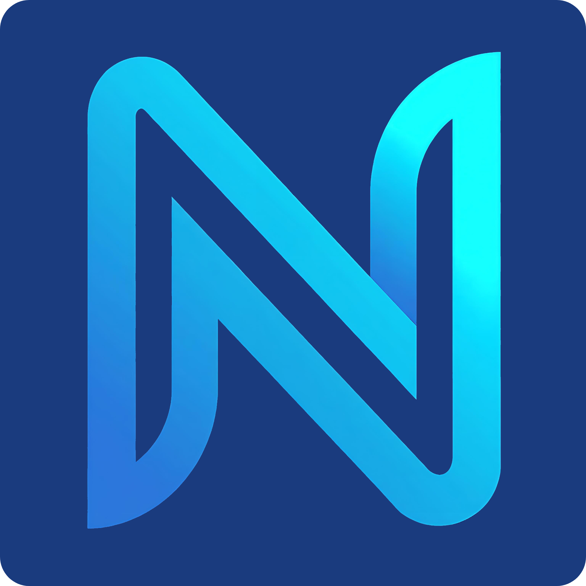

<h1 align="center">Nibbly</h1>

  <b>The all-in-one converter for Android, iOS & Windows</b> 
  Bases · Text · Morse · Bits · Power · Multimedia · Calculator · Formulas · Logic · Flowcharts · Practice · Drawing · Games · Private Mode

  
  
  
  
  
  
  

 
  
  

---

## 📥 Download & Platforms

> **⚡ Pre-built APK available at [Releases](https://github.com/edwarly999plus/Nibbly/releases/latest)**

### 🪟 Windows 10 / 11 (Native x86 & x64)
Nibbly has been **natively ported to Windows 10/11** (both x86 and x64 architectures). 
It uses the **Microsoft Edge WebView2 Runtime** for a lightweight, native window experience.
- If the user doesn't have WebView2 installed, the Windows installer (or compiler) **will automatically download and install it** to ensure Nibbly runs perfectly.
- Available for download in the Releases section.

### 📱 Android
The APK includes the HTML already built and ready to run. **No internet connection required** once installed.
- **Background music** (`mus/You Are Nibbled.ogg` and `mus/Cubic Nibbly.ogg`) is bundled inside the APK.
- **WebView Requirement:** Android 6.0+ with Android System WebView installed (usually preinstalled). If you see a blank screen, update WebView from the Play Store.

### 🍏 iOS (via Safari) — Compatible with iOS 9+
Installed as a **Web Clip** via `.mobileconfig`.
- Works on iOS 9 or higher.
- Background music is bundled if hosted on GitHub Pages, but **autoplay is restricted by Safari** (user must tap the screen first).
- The `.mobileconfig` method avoids jailbreaking and keeps your device secure while providing an app-like icon.

### 🌐 Web / PC
- Available at [GitHub Pages](https://edwarly999plus.github.io/Nibbly/).
- Music is **not included by default** to save bandwidth; it downloads automatically (<5s) from Archive.org when enabled.

---

## 📸 Screenshots

  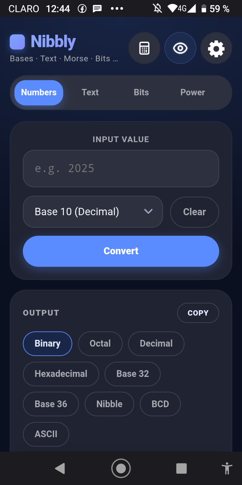
  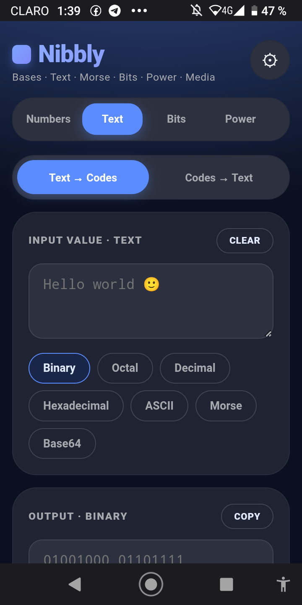
  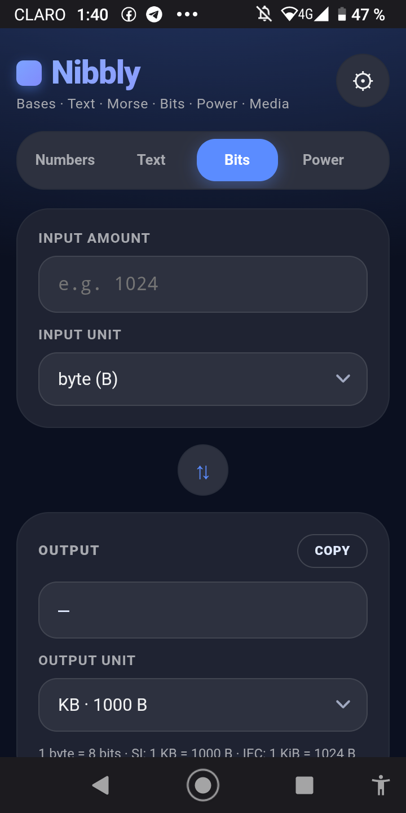
  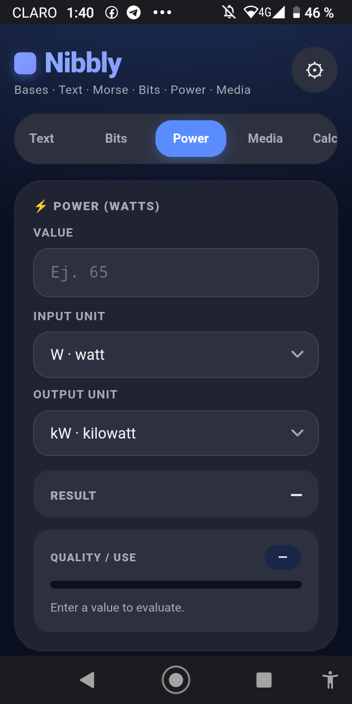
  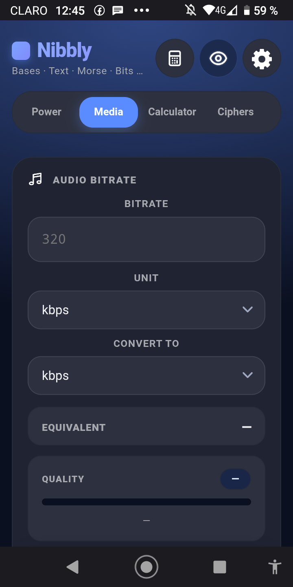

  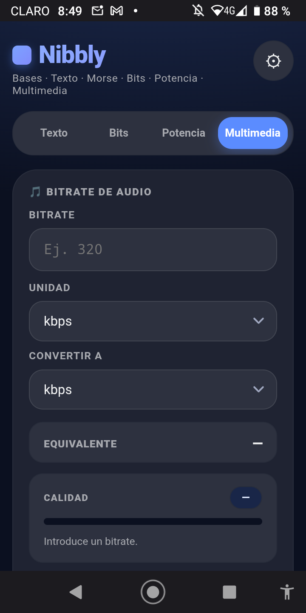
  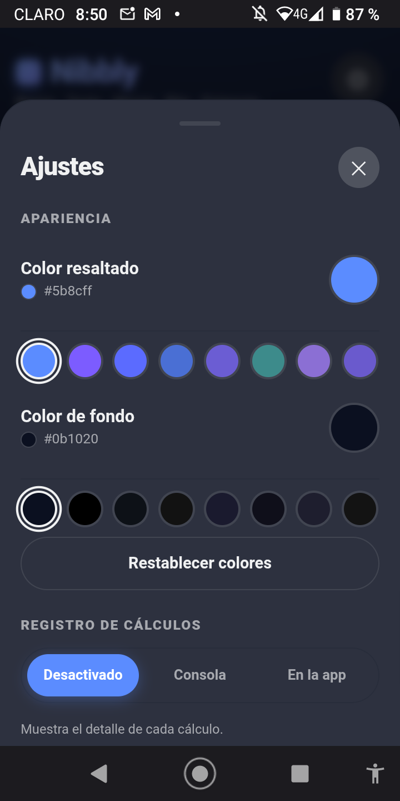
  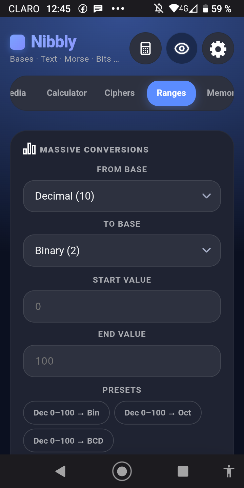
  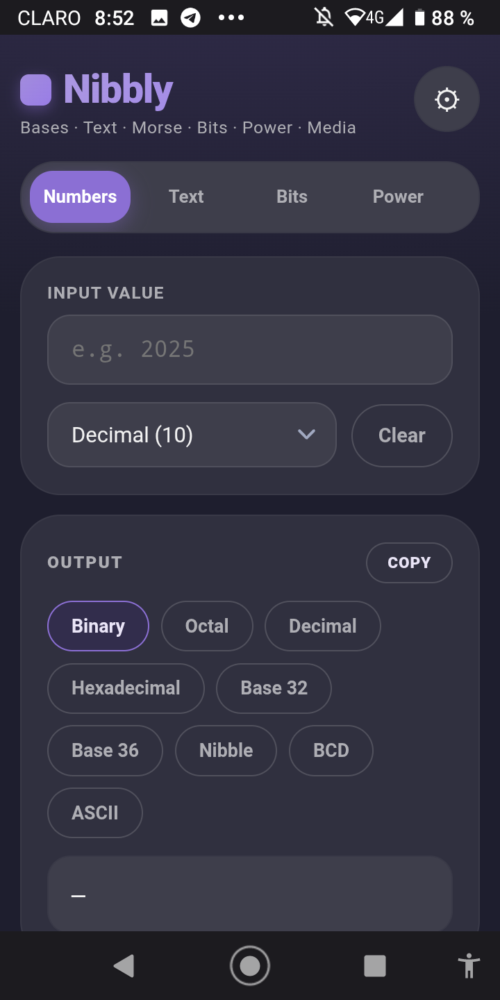
  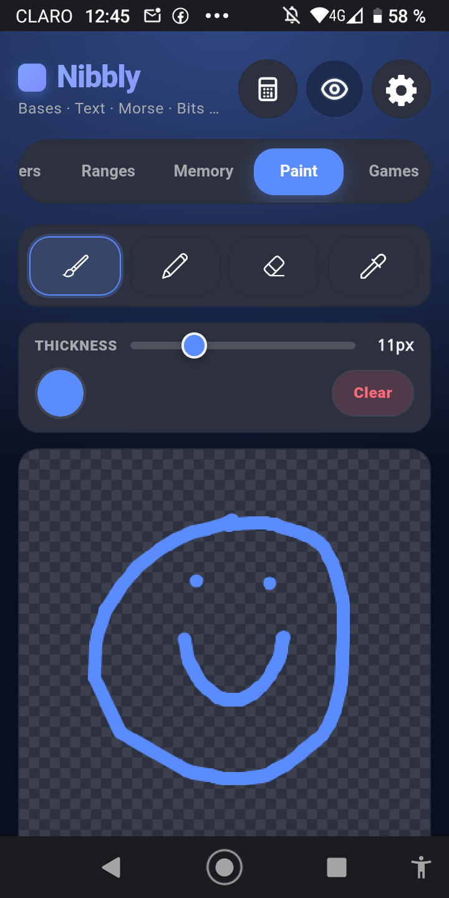
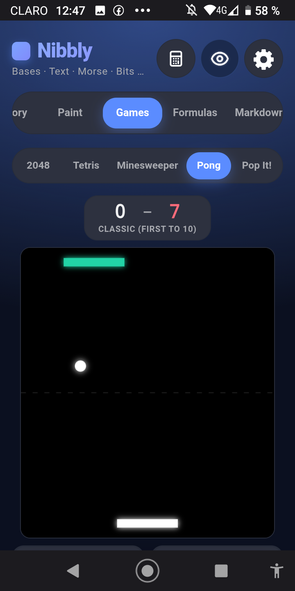
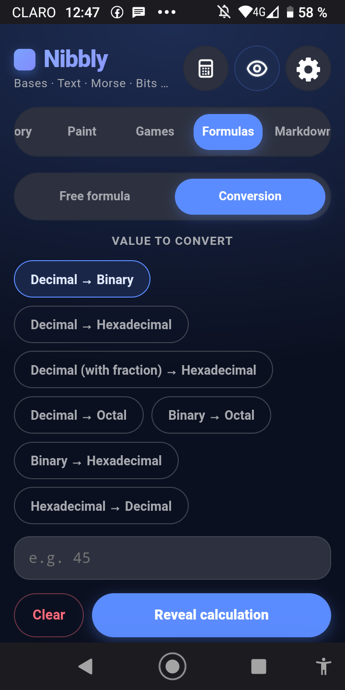
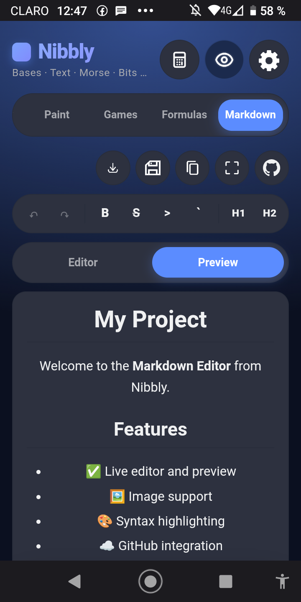
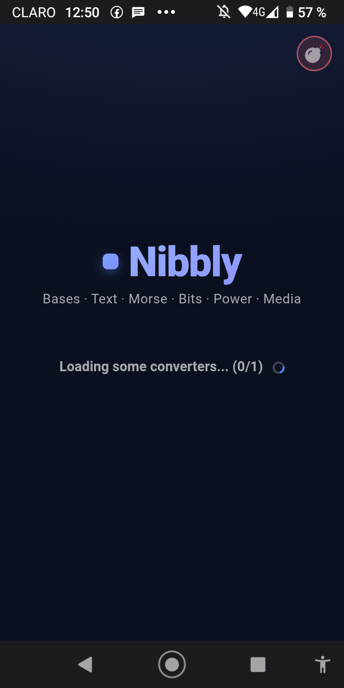
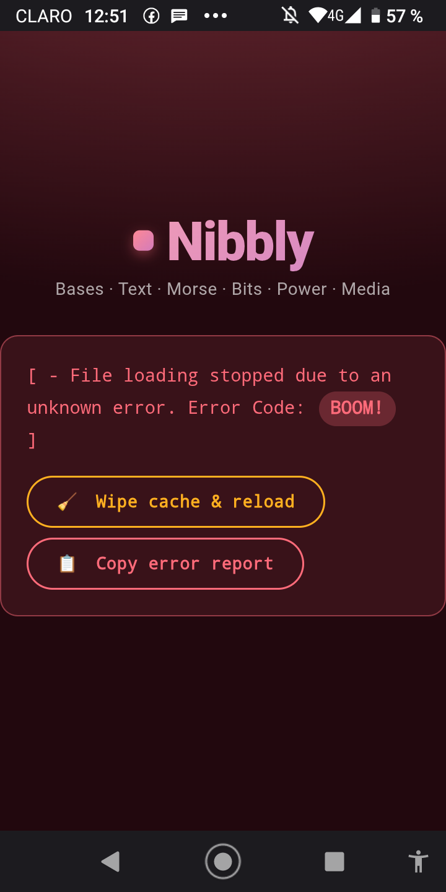

---

## 📖 Description

**Nibbly** is a cross-platform app built with **HTML5 + CSS3 + JavaScript** that bundles over **40 conversion tools**, **a calculator with its own personality**, **a live formula editor with step-by-step math**, **a boolean logic calculator & diagram builder**, **a flowchart editor**, **a practice tab for exam preparation without AI**, **a full cipher suite**, **a Markdown editor with GitHub integration**, **a drawing editor**, **7 minigames**, and **a private mode with a disguised scientific calculator**, all inside a single **Material You 3** interface with customizable themes, sounds, calculation logging, bundled background music, vector icons, and bilingual support.

Lightweight, fast, and **100% offline**. Available natively on Android, iOS, and Windows (WebView2).

**v2.0.6 highlights (The Games & Logic Expansion):**
- 🎮 **Cube Run & Snake** — Two new fully-featured games with local leaderboards, shops, skins, and audio ducking.
- 🧠 **Logic Gates 1.7** — Waveforms visualizer, interactive Wave Maker, SVG/PNG export, and ANSI shapes.
- 🪟 **Windows Native Port** — x86 and x64 builds using Edge WebView2 (auto-installs if missing).

---

## ✨ Features

### 🔢 Numbers
- Conversion between bases **2 – 36**
- Output in **Binary, Octal, Decimal, Hex, Base32, Base36**
- **Nibble** (4-bit blocks) and **BCD**
- **ASCII** and support for large numbers with `BigInt`
- **⏳ "Convert" button** with a 3-second delay and rotating messages
- **🎲 Alphanumeric code generator** with customizable separators

### 📝 Text
- Text ↔ Binary, Octal, Decimal, Hex, ASCII, **Morse**, **Base64**
- Full **Unicode** support (emojis included)
- **Built-in Morse keyboard** and **Morse player** (audio + .wav download)

### 💾 Bits
- **bit, byte, KB, MB, GB, TB, PB, EB, ZB, YB** (SI)
- **KiB, MiB, GiB, TiB, PiB, EiB, ZiB, YiB** (IEC)
- **🔢 Combinations calculator**

### ⚡ Power
- **Watts**, **🌡️ CPU heat meter**, **Connection speed**, **CPU (GHz)**, **🧠 RAM** (DDR1-5), **💾 Storage** (HDD, SATA, NVMe).

### 🎵 Multimedia
- **Audio bitrate**, **Decibels** (with spectrum), **Video resolution**, **Time converter**, **🎞️ Frames**, **Codec info**.

### 🧮 Calculator
- Classic functions with optional physics explosion (Please Don't) or black hole.

### 🧮 Fórmulas
> Loaded as an external expansion (`formulas/formulas.css` and `formulas/formulas.js`).
- **Free formula** (live evaluation)
- **6 new Step-by-Step conversions** (Bin→Dec, Oct→Bin, Hex→Dec, etc.)
- **Remainder Finder** (long division)
- **Boolean Logic Calculator & Diagrammer**
- 3 loading messages, then full procedure + copy button.

### 📚 Práctica (Practice Tab)
- **No AI required** — Built specifically to practice exams locally and completely offline.

### 🔐 Ciphers
- **Classical**: Caesar, ROT13, ROT47, Atbash, Vigenère, Affine, Substitution
- **Encodings**: URL, Unicode, XOR
- **Modern**: AES-256-CBC, DES, 3DES
- **Stream**: RC4, Rabbit
- Real-time debounced rendering.

### 📐 Flowcharts & Logic Gates
- **Flowcharts**: Smooth dragging, Nibbly modals, 60 FPS, export to SVG/PNG.
- **Logic Gates (v1.7.0)**:
  - **Waves**: Visualizer with time grid.
  - **Wave Maker**: Interactive cell grid, presets, JSON/SVG/PNG export.
  - **Builder**: Real ANSI/IEEE gate shapes (D-shape, shield, triangle).
  - **Concepts**: Expandable cards explaining time, cycles, and edges.

### 📊 Range & Memory
- **Range**: Up to 100,000 entries, CSV export, pagination.
- **Memory**: 4,096 bytes, hex addresses, persistence.

### 🎨 Drawing & Private Mode
- **Drawing**: Brush, Pencil, Eraser, Eyedropper, RGBA/HEX copy.
- **Private Mode**: Disguised scientific calculator, black screen (3 taps to exit), auto-pauses music.

### 🎮 Games (7 Minigames)
- **2048, Tetris, Minesweeper, Pong, Pop It!**
- **Snake (v1.5.1)**: 3 difficulties, "Grace" delay (0.2s) on walls, input queue.
- **Cube Run (v2.1.5)**: Endless runner, 3 difficulties (1, 2, 3 spikes), **Coin Shop with 6 Skins**, **Audio Ducking** (lowers main app music to play "Cubic Nibbly.ogg"), safe-spawn coin algorithm.

### 📄 Markdown editor
- Editor + preview, format bar, GitHub integration, Focus mode, offline-safe.

### 🖥️ Desktop UI & Windows Port
- **Desktop UI (Web)**: Sidebar, card grid, keyboard shortcuts (1-9).
- **Windows Native**: Built for x86/x64 using **Edge WebView2**. If missing, the installer handles it automatically. No desktop-ui folder required; uses native windowing.

### ⚙️ Settings
- Custom accent/background colors, Log mode, Visual effects toggle (respects `no-effects` in games), Sounds/Music volume, Language (ES/EN), File checker, Update bell.

### 🎨 Vector icons (Optimized)
- **60+ icons**, 100% Inline SVG, `NibblyIcons.get()`, CSS tinting, Emoji fallback. Inline-flex buttons guaranteed.

---

## 🚀 Installation

### 📦 Option 1 — Windows (Native)
1. Go to **[Releases](https://github.com/edwarly999plus/Nibbly/releases/latest)**.
2. Download `Nibbly-Setup-x64.exe` or `Nibbly-Setup-x86.exe`.
3. Run the installer. It will check for **Edge WebView2** and install it silently if needed.
4. Launch Nibbly from the Start Menu.

### 📱 Option 2 — Install the APK (Android)
1. Download `.apk` from Releases.
2. Enable "Install from unknown sources".
3. Install and open. (Music is bundled).

### 🍏 Option 3 — Install on iOS (Safari)
1. Download the `.mobileconfig` file from Releases using Safari.
2. Open **Files app**, tap the `.mobileconfig`.
3. Click "Close" when prompted, go to **Settings > General > VPN & Device Management**, and install the profile.

### 🌐 Option 4 — Try Online / Build from Source
- **Try Online**: [https://edwarly999plus.github.io/Nibbly/](https://edwarly999plus.github.io/Nibbly/)
- **Build**: The `nibbly/` folder structure is the same. For Windows (using WebView2), simply compile the same web assets into a Windows executable using Edge WebView2 wrapper (e.g., WebView2 SDK, Tauri, or a simple C# wrapper). Do NOT copy the `desktop-ui/` folder, as the Windows build uses the default mobile UI in a resizable window, or the desktop UI if desired.

---

### 🔒 Privacy
· ❌ Doesn't collect any data
· ✅ All settings are saved locally

---

### 🎮 Easter eggs
· Pong 7–0: reach a score of 7–0 in Pong.
· Please Don't: enables physics explosion / black hole.

---

### 🗺️ Roadmap
· ☑ v1.0.5 — Fórmulas tab
· ☑ v2.0.0 — The Bigger Update
· ☑ v2.0.1 — Logic Gates
· ☑ v2.0.2 — Diagrams, iOS Support & Fixes
· ☑ v2.0.3 — Bug fixes & Flowchart QoL
· ☑ v2.0.4 — Practice Tab
· ☑ v2.0.5 — Practice Tab icon patches
· ☑ v2.0.6 — Logic Gates Waves, Wave Maker, Cube Run, Snake, Windows Port (WebView2)
· ☐ v2.0.x — More bug fixes
· ☐ v3.0.x — (Soon...)

---

### 🤝 Contributing
1. Fork the project
2. Create a branch: `git checkout -b fix/bug-name`
3. Commit: `git commit -m "fix: bug description"`
4. Push: `git push origin fix/bug-name`
5. Open a Pull Request

---

### 👤 Author
EdwarlyGamer999+
· 🐙 GitHub: @edwarly999plus
· 📦 Repository: Nibbly

---

### 📄 License
Apache-2.0. See the LICENSE file for details.

---

  <b>Made with ♥️ by EdwarlyGamer999+</b> 
  ⭐ If you liked the project, give it a star on GitHub ⭐

  
  
  

